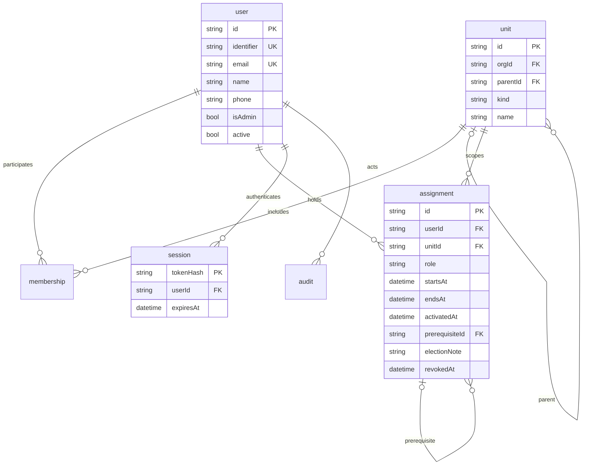
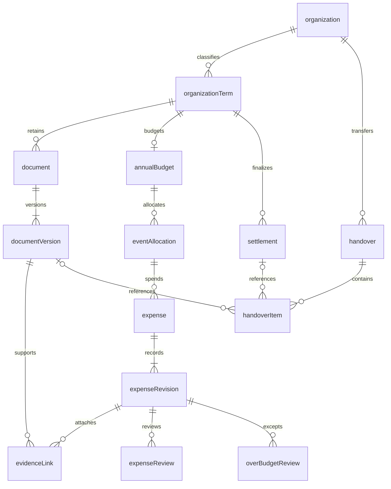
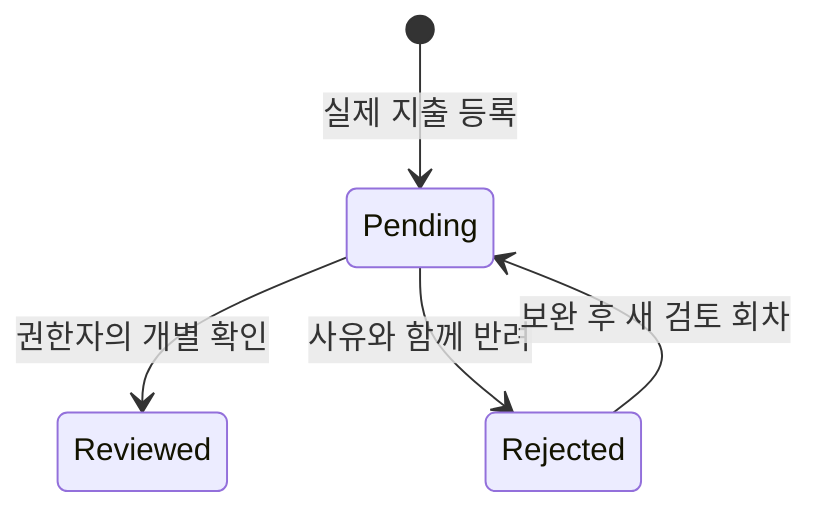
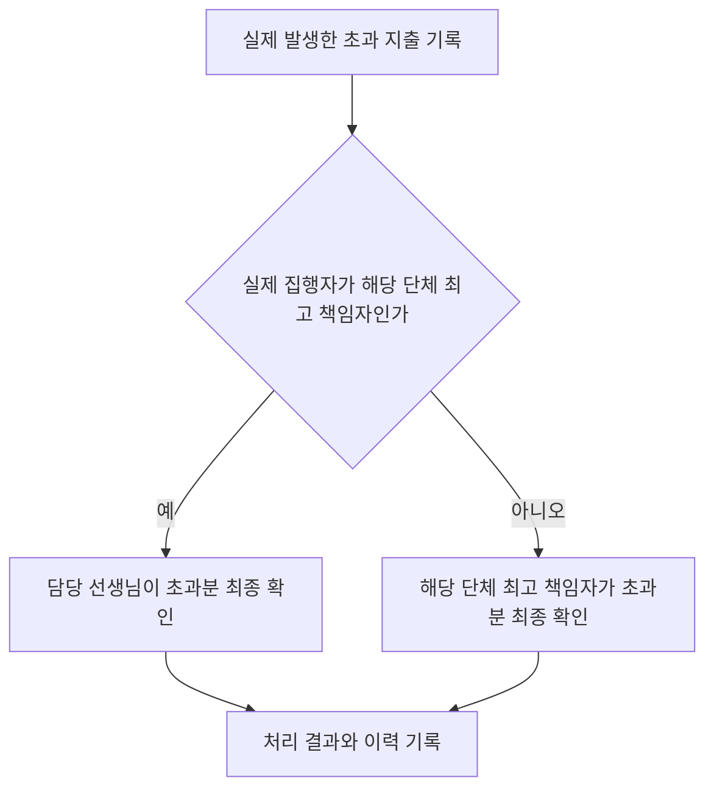
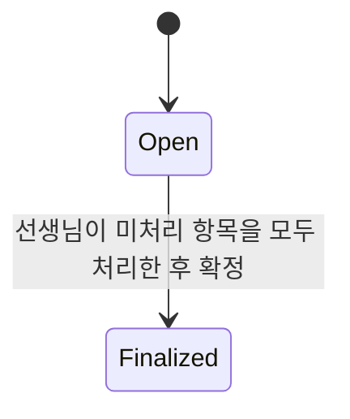
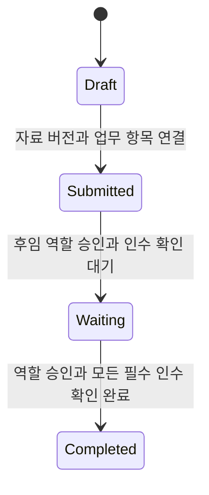
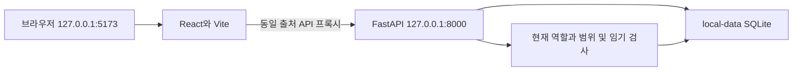

# 1차 상세 설계와 프로토타입 경계

2026-11-12. [도메인 모델](../DOMAIN_MODEL.md), [기능명세](../FUNCTIONAL_SPEC.md), [권한 명세](../ACCESS_CONTROL.md)를 기준으로 한다. 구현 범위는 M-01~03 및 역할 회수·감사 부분이다. 자료·회계·인수인계는 아래 논리 설계 단계이며 실행 코드가 있다고 해석하지 않는다.

## 구현된 데이터 관계

단체·학과·학년·반은 unit의 서로 다른 종류다. 동일 상위 단위·종류·이름은 중복 생성하지 않는다. 공식 임기는 시작 포함·종료 미포함이며 모든 API의 저장 시각은 UTC다. 화면은 사용자 기기의 한국 시간 환경에서 표시한다. 학년도는 권한 판정의 임기가 아니다.

의장은 본인의 학회장 assignment를 전제로 가지며 공식 시작·종료가 일치해야 한다. activatedAt은 서버가 서비스 역할을 부여한 시각으로 별도 기록한다. 현재 유효한 학회장 자격과 선출 확인 메모가 있어야 선생님이 의장 권한을 부여할 수 있다. 최초 학회장 등록은 선생님이 수행한다(DM-C06). 실제 투표는 포털 밖의 사실이며 투표 기능은 구현하지 않았다.

## 후속 핵심 기능의 논리 ERD

아래 엔터티는 계획이다. 물리 스키마·마이그레이션은 해당 기능 구현 때 확정한다.

지출의 등록자·실제 집행자·확인자를 구분한다. 행사 배정과 지출의 범위·운영기는 일치해야 하며, 증빙은 허용된 같은 단체의 특정 버전으로 연결한다. 인수인계는 같은 단체의 다른 운영기 또는 같은 운영기의 중도 교체를 수용한다. 자료·예산·감사 이력은 담당자 종료로 연쇄 삭제하지 않는다.

## 역할별 현재 권한

| 주체 | 계정·역할 등록 | 조회·감사 |
|---|---|---|
| 담당 선생님 | 최초 학회장·단체 최고 책임자 등록, 단체 추가·삭제, 담당자 제거, 역할 회수 | 전체 가상 담당자·연락처·감사 |
| 의장 | 협의회 하위 학회장·부학회장·반대표 | 협의회 담당자·연락처·감사, 자신의 학회장 범위 겸임 |
| 학회장 | 자기 학과의 부학회장·반대표 | 자기 학과 담당자·연락처. 전체 감사는 불가 |
| 학생회장·국장·연합동아리장 | 자기 단체에 맞는 하위 역할 | 자기 단체 담당자·연락처·감사 |
| 그 밖의 하위 담당자 | 재위임 불가 | 자기 담당 범위의 명단, 자신의 연락처와 최고 책임자 연락처 |
| 역할 미부여 계정 | 등록·부여 불가 | 본인 정보·최고 책임자 연락처만 |

서비스 관리자 계정의 생성·교체는 아직 관리 화면으로 제공하지 않는다. 선생님의 학생 계정 비활성화는 담당자 제거로 제공한다. 일반 소속 변경 화면·회계 입력 권한은 후속이며, 삭제 계정 복구는 S19의 같은 학번·이메일 재등록으로 제공한다. 최고 책임자·학회장·반대표 동일 범위의 겹치는 재임은 이 프로토타입에서 차단하는 임시 선택(P)이며 실제 정원·대행 정책은 DM-O01에서 확정한다.

## 지출 확인과 초과분 처리 설계

이 상태 변화는 실제 사용 사실을 지우지 않는다. 실제 집행 기준 잔액 = 예산 − 해당 범위의 실제 지출 현재 반영액이다. 검토 대기·확인 완료·반려 금액은 별도 집계하고 다시 차감하지 않는다. 예산 100,000원에 실제 120,000원이면 잔액 -20,000원·초과 20,000원이다. 수정 회차를 중복 합산하지 않는다(DM-C04).

대리 등록자는 이 경로를 바꾸지 않는다. 초과분 확인은 예산 자동 증액이나 전체 정산 확정이 아니다. 결과의 세부 종류·환불·정정 반영 시점은 DM-O02 미정이다.

정산 확정 뒤 원본을 덮어쓰지 않고 별도 정정 이력을 남기는 설계다. 미처리의 세부 판정과 정정 승인자는 회계 구현 전 결정한다.

## 인수인계 상태 설계

역할 승인과 인수 확인은 별도 기록한다. 대리 작성자가 인수자를 대신해 필수 확인을 끝내지 못한다. 자료 원본과 지출을 새 담당자의 새 기록으로 복제하지 않는다.

## 로컬 실행 구조

고정된 가상 비밀번호·로컬 HTTP 쿠키·샘플 계정은 데모 전용이다. 외부 네트워크에 노출하거나 실데이터를 반입하지 않는다. 운영에는 Cognito 등 인증, HTTPS, 세션·계정 복구·로그인 제한, PostgreSQL 마이그레이션·동시성·백업 복구, AWS 연결을 별도 검증한다. [FastAPI 보안 문서](https://fastapi.tiangolo.com/tutorial/security/oauth2-jwt/), [React 시작 지침](https://react.dev/learn/build-a-react-app-from-scratch), [Vite 안내](https://vite.dev/guide/)를 참고했다.

## 관리자 관리 흐름 보완 (2026-11-13)

`units.active`를 기존 DB에 비파괴 추가한다. 기존 단체·계정·역할은 초기화하지 않으며 모니터링단 기본 단위만 누락 시 추가한다. 관리자 등록은 운영 단체만 노출한다. 역할의 학과/학년/반 범위는 별도로 유지한다.

`POST /api/organizations`와 `POST /api/organizations/{id}/remove`는 관리자만 사용한다. 삭제는 ‘삭제하겠습니다’ 확인 문구 입력 후 하위 단위 비활성화와 미회수 역할 종료·감사를 같은 트랜잭션으로 남긴다. `POST /api/users/{id}/remove`는 정확한 확인 문구를 서버에서도 검사하고, 학생 계정 비활성화·세션 제거·역할 회수·감사를 함께 처리한다. `users.active`와 원래 역할·외래키 참조를 유지하므로 과거 감사·역할은 삭제하지 않는다. 개인정보 영구 삭제·보유 기간은 이 구현으로 확정하지 않는다.

동명 단체 재등록은 운영 중이면 409, 삭제 상태이면 기존 ID의 단체·하위 소속 active만 복원하고 200/restored=true를 반환한다. 새 단체는 201/restored=false다. 복원은 관리자 트랜잭션·감사로 기록하며 기존 assignments.revoked_at 및 users.active는 바꾸지 않는다.

계정 등록·복구·로컬 초대·복수 소속은 [INVITATIONS.md](INVITATIONS.md)의 최신 구현을 따른다. users.email_verified와 invitations/local_outbox를 기존 DB 초기화 없이 추가한다. 일반 학생 등록은 unit_ids 배열이며 학번·이메일이 모두 일치하는 삭제 계정은 선생님만 복구한다. 학교 본인 확인·외부 메일 전송과 로컬 인증 상태는 별개다.

S20의 최신 역할 정의·단체별 이름·종류 삭제와 연쇄 회수·범위 우선 선택은 [ROLE_CATALOG.md](ROLE_CATALOG.md)를 따른다. role_definitions를 기존 DB 초기화 없이 추가하고 기존 assignments.role의 기본 코드를 유지한다. 일반 역할 코드로 관리자·의장 자격을 만들 수 없으며 추가 역할은 별도 임기 부여가 필요하다.

S22의 공유 대상/관리 범위 분리, 학회장 학년·반 생성·계정 등록과 의장 카드 표시는 [ACADEMIC_SCOPES.md](ACADEMIC_SCOPES.md)를 따른다. 현재 역할에 따른 sharing_groups와 unit_creation_options를 서버에서 계산하며 학회장/부학회장의 협의회 그룹 참여를 조직 루트 관리 권한으로 해석하지 않는다. 실제 문서 공유·다운로드는 미구현이다.
